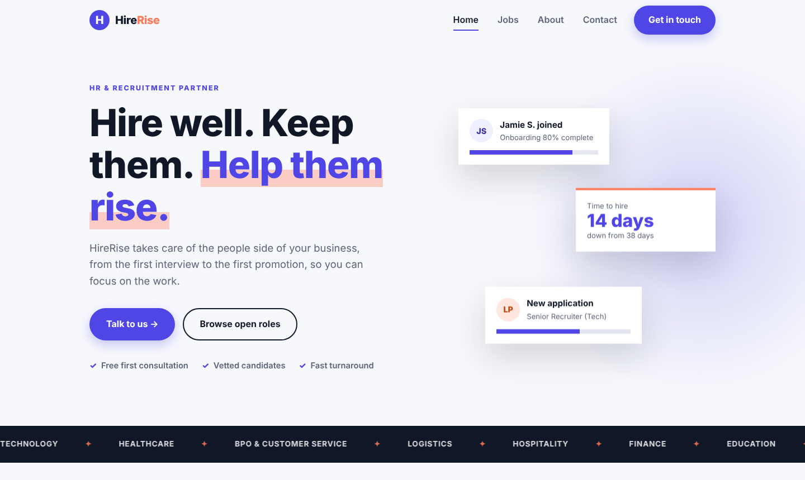

<div align="center">


# HireRise

**An HR and recruitment website that helps companies hire well, keep people, and help them rise.**

Browse and filter open roles, apply with one click, and get in touch through a validated contact form.


[Live demo](#) · [Features](#features) · [Run it locally](SETUP.md) · [Roadmap](#roadmap)

</div>

---

## Screenshots

<p align="center">
  
</p>

## Try it in 30 seconds

No sign-up and no backend needed. Open the **Jobs** page, type `recruit` in the search box, then pick **Contract** in the type filter and watch the list narrow live. Press **Apply** on any role and the contact form opens with the subject and message already filled in.

## Features

**Jobs board**
- Search by title or location, and filter by department and job type
- Live result count, and a friendly message when nothing matches
- **Apply** button passes the role to the contact form (the role name travels in the URL)

**Contact form**
- Per-field validation with clear error messages (name, email, optional phone, topic, message)
- Errors appear when you leave a field and again on submit
- Success message after sending (a prototype: nothing is sent yet)

**Company pages**
- Home with hero, services, stats, how it works, featured roles, testimonials and call to action
- About page with story, values, timeline and team
- Four pages with real URLs: `/`, `/jobs`, `/about`, `/contact`

**Experience**
- Animated line-art icons that draw themselves when they scroll into view
- Count-up numbers, floating hero cards, a sliding industry strip and scroll reveals
- Fully responsive, with a full-screen hamburger menu on phones

## How it works

```
Vue 3 app (Vite)  ──Vue Router──▶  Home · Jobs · About · Contact
        │
        └── sample data in src/data/jobs.js   (a backend replaces this later)
```

There is no backend yet. The 8 sample jobs live in `src/data/jobs.js`, and the contact form only validates and shows a success message. See the [roadmap](#roadmap) for the plan to make both real.

Frontend routes: `/` (home), `/jobs`, `/about`, `/contact`. Unknown URLs redirect to `/`.

### Engineering decisions worth knowing about

1. **One source of truth for the filters.** The search box and both dropdowns are bound with `v-model`, and the visible list is a single `computed()` value. Change any control and the list and the "8 open roles" count update together, with no manual re-rendering.
2. **Data is separate from the screens.** Jobs, icons and page content live in plain arrays, so swapping the jobs array for `fetch('/api/jobs')` later is a one-file change.
3. **One shared scroll observer.** The `v-reveal` directive uses a single `IntersectionObserver` for every element on the page instead of one per element, and stops watching each element after its first reveal.
4. **Lazy-loaded pages.** Jobs, About and Contact are loaded with `() => import(...)`, so the browser downloads each page only when you visit it.
5. **The Apply link carries the role in the URL.** `/contact?role=HR+Intern` can be refreshed, bookmarked or shared, and the form pre-fills from it.
6. **Line-art icons without an animation library.** Every icon shape gets `pathLength="1"`, so a CSS `stroke-dashoffset` animation can "draw" any icon the same way.

## Run it locally

Short version: `npm install`, then `npm run dev`, then open http://localhost:5173.

The full step-by-step guide, deployment notes and troubleshooting are in **[SETUP.md](SETUP.md)**.

## Roadmap

- [ ] Backend and database for jobs and contact messages (Express + MySQL, or FastAPI + Postgres)
- [ ] Job detail page (`/jobs/:id`) and a real application form with CV upload
- [ ] Admin page to post and close jobs
- [ ] Automated tests (Vitest for components, Playwright end to end)
- [ ] Server-side rendering with Nuxt for better search ranking
- [ ] Real content, photos and a deployed live demo
