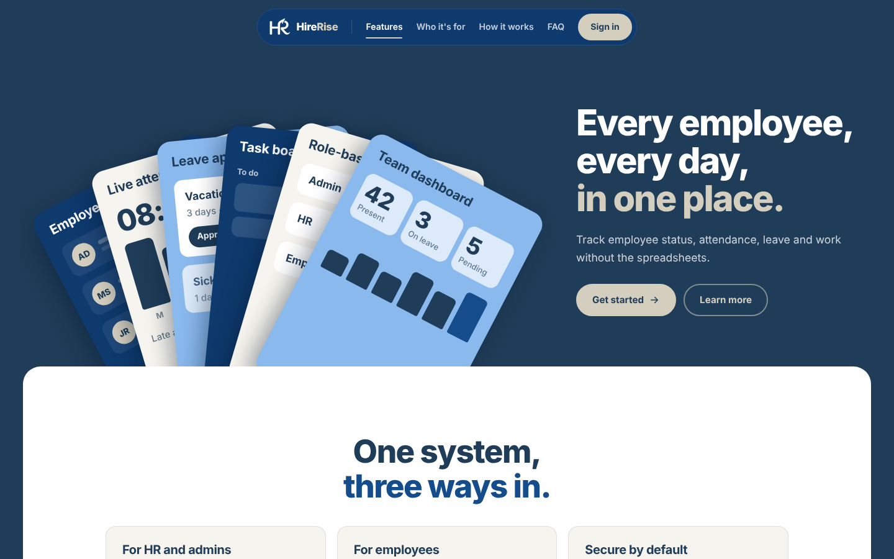
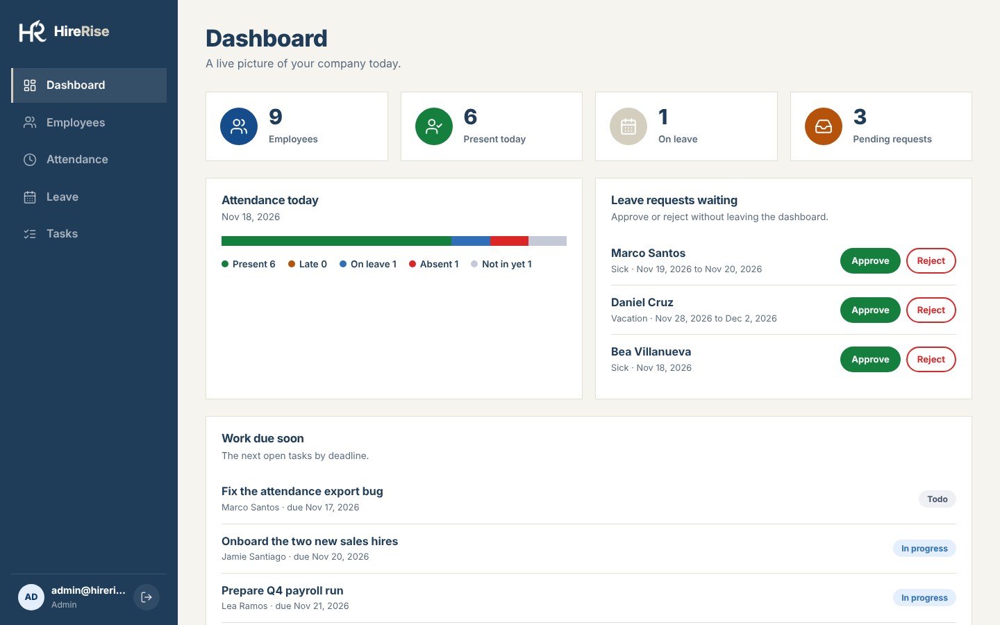
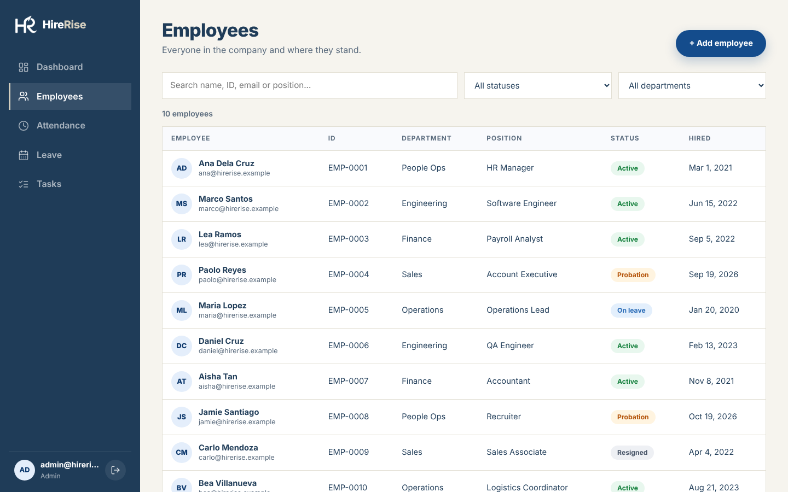
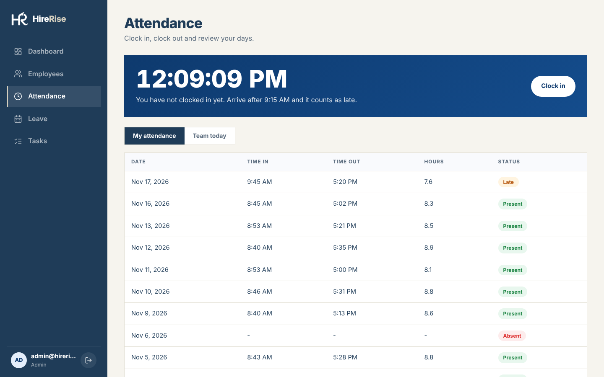
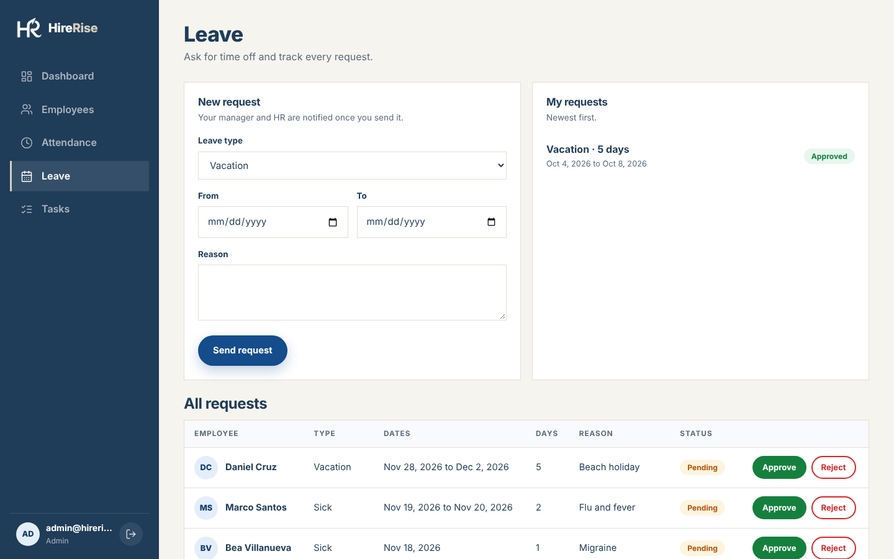
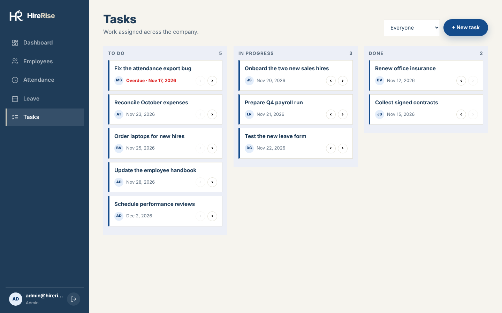
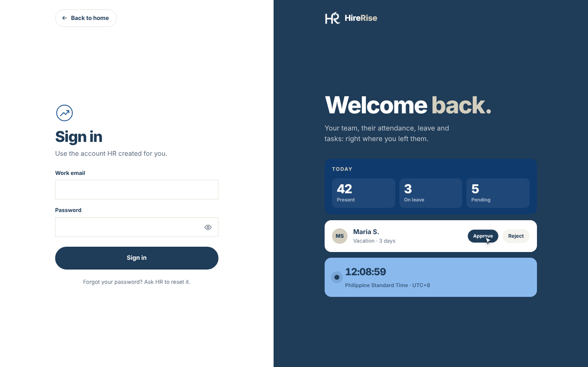
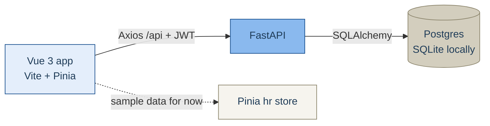

<div align="center">



<br/>


###  [Setup guide](SETUP.md) &nbsp;·&nbsp;  [Features](#-features) &nbsp;·&nbsp;  [Roles](#-roles) &nbsp;·&nbsp;  [Quick start](#-quick-start) &nbsp;·&nbsp;  [Roadmap](#-roadmap)

[](docs/screenshots/landing.png)

</div>

An internal HR management system. Track employee status, attendance, leave and tasks in one place, with a separate, simpler view for employees.

> [!NOTE]
> HireRise is a full-stack portfolio project, built to learn how a real login, role-based pages and an API fit together.

> [!WARNING]
> Work in progress. Login, roles and route guards run on the real backend. Employees, attendance, leave, tasks and the dashboard use **sample data in the browser** for now, and reloading the page resets it. See [Current status](#-current-status).

---

<h2> Features</h2>

<table>
  <tr>
    <td width="33%" valign="top">
      <br/>
      <b>Company dashboard</b><br/>
      Headcount, who is present or on leave today, pending requests and the work due soon, on one screen.
    </td>
    <td width="33%" valign="top">
      <br/>
      <b>Leave approvals</b><br/>
      Approve or reject leave requests straight from the dashboard, without opening another page.
    </td>
    <td width="33%" valign="top">
      <br/>
      <b>Employee directory</b><br/>
      Search, filter by status and department, and add a new employee with a form.
    </td>
  </tr>
  <tr>
    <td valign="top">
      <br/>
      <b>Team attendance</b><br/>
      Everyone's status for today: present, late, on leave, absent or not in yet.
    </td>
    <td valign="top">
      <br/>
      <b>Task board</b><br/>
      To do, In progress and Done columns, with an assignee filter and overdue markers.
    </td>
    <td valign="top">
      <br/>
      <b>Employee view</b><br/>
      A personal dashboard with hours, leave balance and open tasks. Employees only see their own tasks.
    </td>
  </tr>
  <tr>
    <td valign="top">
      <br/>
      <b>Clock in and out</b><br/>
      One button to clock in or out. Arriving after 09:15 counts as late. Leave requests are validated before they are sent.
    </td>
    <td valign="top">
      <br/>
      <b>Role-based pages</b><br/>
      An employee who opens <code>/employees</code> is sent back to the dashboard. The router decides, not the page.
    </td>
    <td valign="top">
      <br/>
      <b>Secure login</b><br/>
      JWT sessions and bcrypt passwords. The role is read from the database on every request, so deactivating a user works at once.
    </td>
  </tr>
</table>

<h2> Roles</h2>

| Role | Dashboard | Employees | Attendance | Leave | Tasks |
|---|---|---|---|---|---|
| admin | company-wide | yes | everyone | approve and reject | all tasks |
| hr | company-wide | yes | everyone | approve and reject | all tasks |
| employee | personal | no | own only | own requests | own tasks |

<h2> Screenshots</h2>

<details open>
<summary><b>Dashboard and Employees</b></summary>
<br/>

| Dashboard | Employees |
|---|---|
|  |  |

</details>

<details>
<summary><b>Attendance, Leave and Tasks</b></summary>
<br/>

| Attendance | Leave |
|---|---|
|  |  |

| Tasks |
|---|
|  |

</details>

<details>
<summary><b>Login</b></summary>
<br/>



</details>

<h2> Current status</h2>

| Part | State |
|---|---|
| Login, roles, route guards | Real (backend) |
| Employees, attendance, leave, tasks, dashboard | **Sample data in the browser** (`frontend/src/stores/hr.js`), replaced by API calls one module at a time |

The database models for all of these already exist in `backend/app/models.py`.

<h2> Quick start</h2>

```bash
git clone https://github.com/RebEmnacin/HireRise.git
```

<details open>
<summary> <b>Terminal 1: backend</b> (Python 3.11+)</summary>

```bash
cd HireRise/backend
python -m venv venv
source venv/bin/activate        # Windows: venv\Scripts\activate
pip install -r requirements.txt
cp .env.example .env            # Windows: copy .env.example .env
uvicorn app.main:app --reload --port 8000
```

</details>

<details open>
<summary> <b>Terminal 2: frontend</b> (Node 20.19+ or 22.12+)</summary>

```bash
cd HireRise/frontend
npm install
npm run dev
```

</details>

Open http://localhost:5173 and sign in with the admin email and password from your `.env`.

> [!IMPORTANT]
> The backend won't start without a `SECRET_KEY`, and the first admin is only created when `FIRST_ADMIN_EMAIL` and `FIRST_ADMIN_PASSWORD` (8+ characters) are set. Fill all three in `backend/.env` before the first start. Everything else, including Postgres, is in the **[setup guide](SETUP.md)**.

<h2> How it works</h2>



The frontend and the API are separate apps. In development Vite forwards `/api` to FastAPI. In production, set `VITE_API_URL` to the real backend. Interactive API docs are served at `/docs` on a running backend.

<details>
<summary> <b>Tech stack, and why</b></summary>
<br/>

| Layer | Choice | Why |
|---|---|---|
| UI | Vue 3 (`<script setup>`) | Small single-file components, with the template, logic and styles together |
| Build | Vite 7 | Instant dev server and fast builds |
| State | Pinia | One store for the login, one for the HR data |
| Routing | Vue Router | Guards read `meta`, so access rules live in one file |
| HTTP | Axios | One client that adds the token to every request |
| Motion | `motion`, `motion-v` | Scroll-linked and spring animation on the landing and login pages |
| API | FastAPI | Typed request and response models, and free interactive docs |
| Auth | PyJWT + bcrypt | Signed tokens, and hashed passwords |
| Database | SQLAlchemy 2 | SQLite for a zero-setup local run, Postgres for production |

</details>

<details>
<summary> <b>API at a glance</b></summary>
<br/>

| Area | Endpoints |
|---|---|
| Health | `GET /api/health` |
| Auth | `POST /api/auth/login` · `GET /api/auth/me` · `POST /api/auth/change-password` |

The employees, attendance, leave, tasks and dashboard endpoints are next on the [roadmap](#-roadmap).

</details>

<details>
<summary> <b>Project layout</b></summary>

```
HireRise/
├── backend/app/
│   ├── routers/        auth
│   ├── models.py       SQLAlchemy tables
│   ├── schemas.py      Pydantic request and response shapes
│   ├── security.py     JWT and bcrypt
│   └── seed.py         first admin account
├── frontend/src/
│   ├── views/          Landing, Login, Dashboard, Employees, Attendance, Leave, Tasks
│   ├── components/     AppLayout, StatusBadge, CountUp... and landing/ (one file per section)
│   ├── stores/         auth (real), hr (sample data)
│   ├── router/         routes and guards
│   ├── api/            Axios client and endpoints
│   └── lib/            landing motion helpers, formatting
├── docs/               banner, icons and screenshots used by this README
└── SETUP.md            full setup and environment variables
```

</details>

<h2> Engineering decisions</h2>

1. **One store, one swap point.** Every page reads from `stores/hr.js`. Replacing a store action with an API call changes no page.
2. **Filters are `computed()` values.** Search and dropdowns are bound with `v-model`, and the visible list re-runs by itself.
3. **Route guards read `meta`.** `requiresAuth`, `guestOnly` and `roles` in the router decide who can open what.
4. **No fallback secret.** The backend refuses to start without `SECRET_KEY`.
5. **Timing-equalized login.** A dummy bcrypt check runs for unknown emails, so response time does not reveal which emails exist.
6. **First admin on first start only.** Created from `.env` when the users table is empty.
7. **The landing page is an assembly.** Each section is its own component in `components/landing/`, the wording lives in `data/landing.js`, and the animation helpers are shared.

<h2> Roadmap</h2>

- [ ] Employees API (create, edit, deactivate; also creates the login)
- [ ] Attendance, leave, tasks and dashboard endpoints, then wire `stores/hr.js` to them
- [ ] Password reset by HR, and a change-password page
- [ ] Rate limiting on login
- [ ] Automated tests (pytest for the API, Vitest and Playwright for the UI)
- [ ] Deploy (frontend on Vercel or Netlify, backend on a host with Postgres)

<div align="center">

<br/>


**Built by [RebEmnacin](https://github.com/RebEmnacin)**

</div>